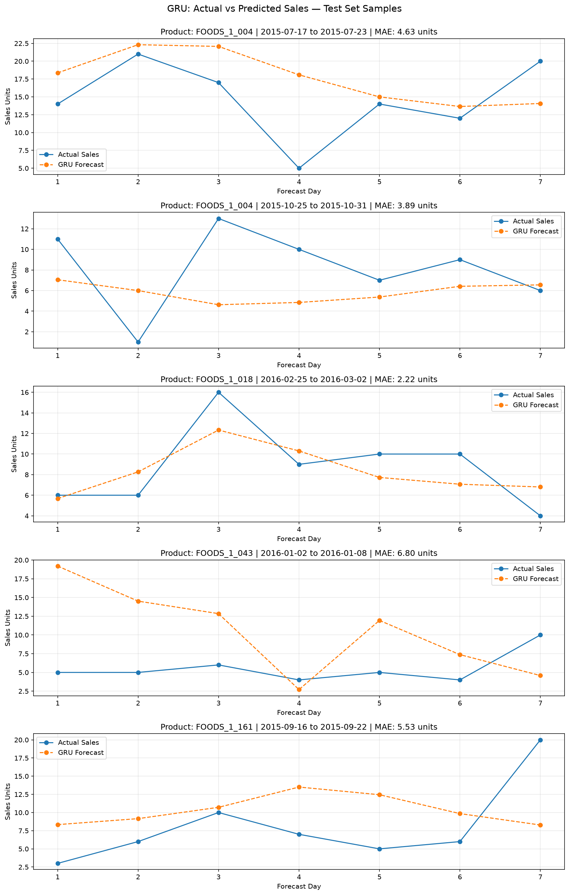
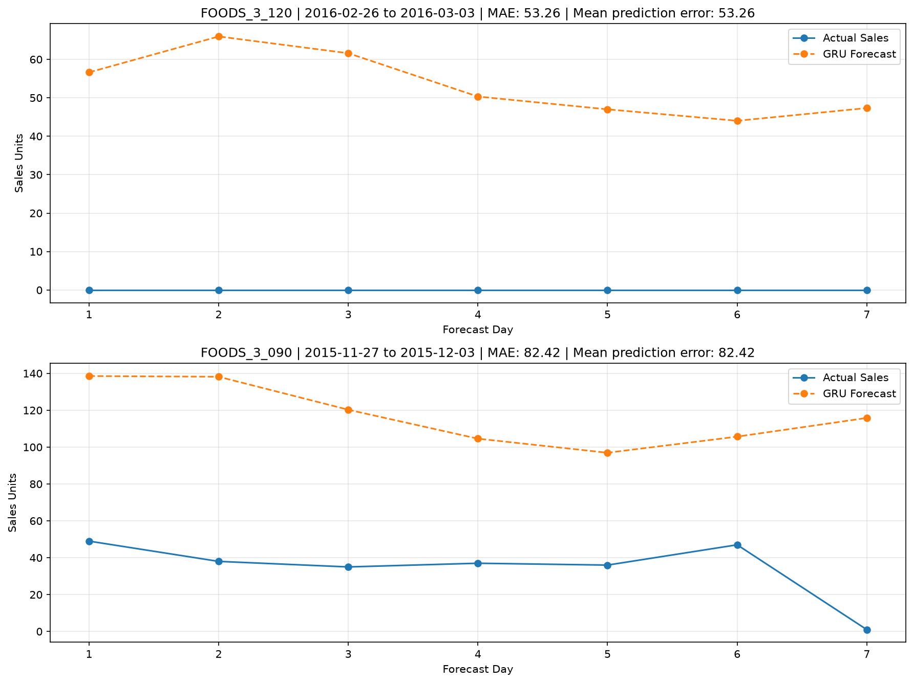

# Deep Learning-Based Time Series Forecasting: LSTM vs GRU

A deep learning project for multi-step retail sales forecasting using Long Short-Term Memory (LSTM) and Gated Recurrent Unit (GRU) networks. The project uses historical sales data to learn temporal patterns and predict future product demand.

## Overview

Accurate demand forecasting is important for retail businesses because it helps with inventory planning, stock replenishment, and reducing overstocking or stockouts.

This project explores deep learning approaches for time series forecasting using the **M5 Forecasting dataset**. It implements and compares two recurrent neural network architectures:

- **LSTM (Long Short-Term Memory):** Captures long-term temporal dependencies in sequential data.
- **GRU (Gated Recurrent Unit):** Uses a simplified gating mechanism to learn temporal patterns with fewer parameters than a typical LSTM.

The models use historical sales patterns and engineered temporal features to generate multi-step demand forecasts.

## Objectives

- Analyze historical retail sales and identify temporal patterns.
- Perform data preprocessing and feature engineering.
- Transform time series data into supervised learning sequences.
- Implement LSTM and GRU forecasting models.
- Compare model performance using multiple evaluation metrics.
- Evaluate forecasting performance across different prediction horizons and products.
- Visualize actual versus predicted demand.

## Dataset

**M5 Forecasting - Accuracy Dataset**

Source: [Kaggle - M5 Forecasting Accuracy](https://www.kaggle.com/competitions/m5-forecasting-accuracy/data)

The dataset contains Walmart retail sales information across products, stores, and time.

The project uses three primary data sources:

| File | Description |
|---|---|
| `sales_train_validation.csv` | Historical daily product sales |
| `calendar.csv` | Calendar information, events, and dates |
| `sell_prices.csv` | Product selling prices across stores and weeks |

The data includes temporal and retail-related information that can be used to identify demand patterns.

**Note:** The original dataset and large processed files are not included in this repository because of their size. Download the dataset from Kaggle and place the required files in `data/raw/`.

## Technology Stack

| Category | Tools and Technologies |
|---|---|
| Programming | Python |
| Deep Learning | TensorFlow, Keras |
| Data Processing | Pandas, NumPy |
| Machine Learning | Scikit-learn |
| Visualization | Matplotlib, Plotly |
| Dashboard | Streamlit |
| Development | Jupyter Notebook, VS Code |
| Version Control | Git, GitHub |

## Project Workflow

### 1. Data Inspection and Preprocessing

- Load and inspect historical sales, calendar, and pricing data.
- Handle missing values and prepare the data for modeling.
- Transform sales records into a suitable time series format.
- Examine product-level demand patterns.

### 2. Feature Engineering

Create additional features to help the models learn temporal relationships.

Examples include:

- Lag features to capture previous sales observations.
- Rolling statistics to capture recent demand trends.
- Calendar-based features to represent time-related patterns.
- Price-related information where applicable.

### 3. Data Splitting and Scaling

- Split the data chronologically into training, validation, and test sets.
- Preserve the temporal order of observations.
- Apply feature scaling to improve model training.
- Avoid using future information during model training.

### 4. Sequence Generation

Convert the processed time series into input-output sequences suitable for recurrent neural networks.

The forecasting setup uses a historical lookback window to predict multiple future time steps.

- Input: Historical time series observations.
- Output: Future demand predictions over a multi-day forecasting horizon.

### 5. Model Development

**LSTM Model**

LSTM networks use memory cells and input, forget, and output gates to learn temporal dependencies in sequential data.

**GRU Model**

GRU networks use update and reset gates to capture temporal patterns with a comparatively simpler architecture.

Both models are trained using the prepared time series sequences.

### 6. Model Evaluation

Evaluate and compare forecasting performance using:

- MAE (Mean Absolute Error)
- RMSE (Root Mean Squared Error)
- Forecast error across different prediction horizons
- Product-level forecasting performance

The project also includes a seasonal naive forecasting baseline for comparison.

### 7. Visualization and Dashboard

A Streamlit dashboard provides an interactive way to explore forecasting results.

It includes:

- Forecast comparisons.
- Actual versus predicted demand.
- Model performance comparisons.
- Forecasting error analysis.
- Product-level forecasting visualizations.

## Repository Structure

```text
deep-learning-time-series/
│
├── app/
│   └── dashboard.py
│
├── data/
│   └── processed/
│       ├── horizon_metrics.csv
│       ├── model_comparison.csv
│       └── product_metrics.csv
│
├── models/
│   ├── lstm_demand_forecasting.keras
│   ├── gru_demand_forecasting.keras
│   ├── scaler.pkl
│   ├── forecast_comparison_5_samples.png
│   └── worst_product_forecasts.png
│
├── src/
│   ├── data_inspection.py
│   ├── data_preprocessing.py
│   ├── feature_engineering.py
│   ├── data_split.py
│   ├── scaling.py
│   ├── create_sequences.py
│   ├── train_lstm.py
│   ├── train_gru.py
│   ├── evaluate_lstm.py
│   ├── compare_models.py
│   ├── evaluate_by_horizon.py
│   ├── evaluate_by_product.py
│   ├── seasonal_naive.py
│   └── ...
│
├── requirements.txt
└── .gitignore
```

## Installation and Setup

### 1. Clone the Repository

```bash
git clone https://github.com/saopreksha19-art/deep-learning-time-series.git

cd deep-learning-time-series
```

### 2. Create a Virtual Environment

```bash
python -m venv venv
```

Activate the environment:

**macOS / Linux**

```bash
source venv/bin/activate
```

**Windows**

```bash
venv\Scripts\activate
```

### 3. Install Dependencies

```bash
pip install -r requirements.txt
```

### 4. Download the Dataset

Download the M5 Forecasting Accuracy dataset from Kaggle.

Place the required CSV files inside:

```text
data/raw/
```

### 5. Run the Streamlit Dashboard

```bash
streamlit run app/dashboard.py
```

## Model Artifacts

Pre-trained model artifacts are available in the `models/` directory:

| Artifact | Description |
|---|---|
| `lstm_demand_forecasting.keras` | Trained LSTM model |
| `gru_demand_forecasting.keras` | Trained GRU model |
| `scaler.pkl` | Fitted feature scaler |

These artifacts allow the saved models and preprocessing scaler to be reused without retraining.

## Results and Analysis

The project includes evaluation outputs and visualizations for analyzing forecasting performance.

**Model comparison**



**Worst product forecasts**



Additional evaluation results are available in:

- `data/processed/model_comparison.csv`
- `data/processed/horizon_metrics.csv`
- `data/processed/product_metrics.csv`

These files contain model comparison, horizon-wise evaluation, and product-level performance information.

## Key Learnings

- Working with large-scale retail time series data.
- Designing preprocessing pipelines for sequential data.
- Understanding lag features and rolling statistics.
- Converting time series data into supervised learning sequences.
- Implementing LSTM and GRU architectures using TensorFlow and Keras.
- Understanding chronological train-validation-test splitting.
- Evaluating multi-step forecasting models.
- Comparing deep learning models against a naive forecasting baseline.
- Building an interactive forecasting dashboard using Streamlit.

## Future Improvements

- Experiment with attention-based forecasting architectures.
- Explore Transformer-based time series models.
- Incorporate additional external variables to improve forecasting accuracy.
- Experiment with hyperparameter optimization.
- Extend forecasting into inventory optimization and replenishment planning.

## Author

**Preksha Sao**

M.Tech Data Science  
Delhi Technological University (DTU)

- GitHub: [saopreksha19-art](https://github.com/saopreksha19-art)
- LinkedIn: [prekshasao](https://www.linkedin.com/in/prekshasao/)

---

If you find this project useful, consider giving the repository a star!
